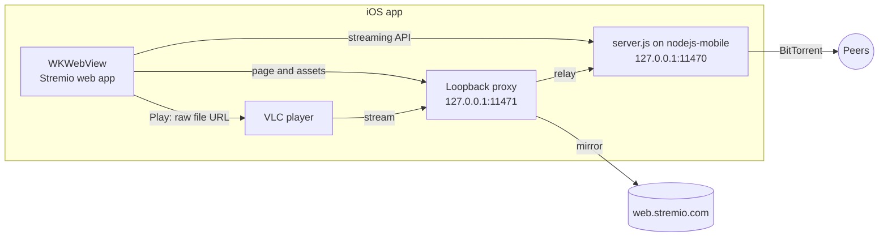

# Stremio for iOS

[](https://github.com/SameetAsadullah/stremio-ios/actions/workflows/ci.yml)


A personal iOS app that runs [Stremio](https://www.stremio.com) on an iPhone or iPad, with torrent
streaming on the device itself.

> [!IMPORTANT]
> This is an unofficial, personal project. It is not affiliated with or endorsed by Stremio.
> The app uses Stremio's own web app and Stremio's own streaming server (`server.js`), which it
> downloads from Stremio at first launch. This repository contains only the iOS app that runs
> them on iOS. It is not for App Store distribution. You are responsible for what you stream.

## Why

The Stremio app in the App Store does not stream torrents. The full app is only available through
AltStore PAL in the EU and Japan. This app runs the same streaming server inside the app, so
torrents play on the phone without a computer, a home server or a debrid service.

## Features

- The official Stremio web app, so the interface stays current with Stremio's releases.
- Stremio's streaming server runs on the device, on `127.0.0.1:11470`.
- Native VLC playback: MKV, HEVC/x265 with hardware decoding, AC3, EAC3, DTS and multiple audio
  tracks.
- Watch progress syncs to your Stremio account: Continue Watching and resume work as in the
  official apps.
- A Next Episode button during the credits. With Stremio's binge watching setting on, the next
  episode plays when one ends.
- Audio and subtitle track pickers. Subtitles from Stremio subtitle add-ons load into VLC.
  Each video starts with the audio and subtitle languages from Stremio's settings.
- Player controls: tap to show or hide, double-tap the left or right side to skip 10 s,
  double-tap the middle for fit or fill, pinch to zoom, scrub, playback speed.
- The player opens in landscape and keeps the screen awake. A resumed video offers Start Over.
- Live buffering status for cold torrents, for example "Buffering from 23 sources · 2.1 MB/s".
- Lock screen and Control Center controls with the title and poster.
- AirPlay mirroring and HDMI output: the phone decodes the video and sends it to the TV as an
  external display.
- Facebook and Apple login, add-on configuration pages and Trakt sign-in open in a Safari sheet.

## How it works



1. The loopback proxy serves `web.stremio.com` from `http://127.0.0.1`. An HTTPS page cannot call
   the HTTP server on `127.0.0.1:11470`, but a page from `127.0.0.1` can.
2. On first launch the app downloads `server.js` from Stremio and checks its SHA-256 before it
   runs it with nodejs-mobile.
3. When you press Play, injected JavaScript takes the raw file URL from Stremio's `/hlsv2`
   request and cancels the server-side transcode. VLC plays the raw file.
4. The proxy relays the stream to VLC. It holds the connection while a cold torrent starts and
   resumes the stream after a break.

[docs/ARCHITECTURE.md](docs/ARCHITECTURE.md) has the details.

## Requirements

- A Mac with Xcode (tested with Xcode 27.2)
- [XcodeGen](https://github.com/yonaskolb/XcodeGen): `brew install xcodegen`
- An iPhone or iPad with iOS 17 or later
- An Apple ID. A free Apple ID signs the app for 7 days. A paid developer account signs it for 1
  year.
- About 1.5 GB of disk space for MobileVLCKit and nodejs-mobile

## Getting started

```bash
git clone https://github.com/SameetAsadullah/stremio-ios.git
cd stremio-ios
make bootstrap   # downloads MobileVLCKit and nodejs-mobile and checks their SHA-256
```

Set your own signing values in `project.yml`:

- `PRODUCT_BUNDLE_IDENTIFIER`: a bundle identifier that is unique to you
- `DEVELOPMENT_TEAM`: your team ID from Xcode → Settings → Accounts

Connect the device, then build and install:

```bash
xcrun devicectl list devices          # find the device identifier
make install DEVICE=<device-id>
```

On the first launch, iOS can ask you to trust the developer. Go to Settings → General → VPN &
Device Management and trust your Apple ID. iOS can also ask you to turn on Developer Mode in
Settings → Privacy & Security.

The app then downloads Stremio's streaming server (about 7 MB). Log in to Stremio and play.

## Keep the app installed

A free Apple ID signs the app for 7 days. After that, the app does not open until you install it
again.

- `scripts/install-on-iphone.sh <device-id>[,<device-id>...] [days-left]` builds `origin/main`
  from a separate clean checkout and installs it on each device. With `days-left`, it skips each
  device whose installed build has more days left than that.
- `scripts/setup-auto-reinstall.sh <device-id>[,<device-id>...] [hour]` installs a launchd agent.
  The agent runs the install script every day and reinstalls on each device with 2 days or fewer
  left.

The Mac must be on, and each device must be on the same Wi-Fi network and unlocked. A device that
misses a run keeps its build and is tried again the next day. A free Apple ID signs for at most 3
devices, and a new device must be in Xcode's device list once before its first install.

## Development

| Command | Action |
| --- | --- |
| `make bootstrap` | Download the frameworks |
| `make generate` | Generate `Stremio.xcodeproj` from `project.yml` |
| `make build` | Build for a generic iOS device |
| `make test` | Run the unit tests on a simulator |
| `make format` | Format the Swift code with `swift-format` |
| `make lint` | Check the Swift code with `swift-format` |
| `make install DEVICE=<id>` | Build and install on a connected device |

`Stremio.xcodeproj` and `Info.plist` are generated. Change `project.yml` instead, and run
`make generate`.

The app logs through `os.Logger` with the subsystem `com.sameetasadullah.stremio`. To see the
logs, open Console.app and filter on that subsystem. The streaming server writes its own log to
`Library/Caches/stremio-server.log` in the app container.

[CONTRIBUTING.md](CONTRIBUTING.md) has the code style and the commit rules.

## Project structure

```
stremio-ios/
├── Stremio/
│   ├── App/                  App entry, AppDelegate, root view, logging
│   ├── Features/
│   │   ├── Onboarding/       First-run screen that downloads the streaming server
│   │   ├── Web/              Web view, injected scripts, Safari sheet for new windows
│   │   ├── Player/           VLC player, tracks, gestures, buffering status
│   │   └── ExternalDisplay/  AirPlay and HDMI output
│   ├── Services/             Streaming server (nodejs-mobile) and loopback proxy
│   └── Resources/            Assets and the injected JavaScript
├── Tests/StremioTests/       Unit tests
├── scripts/                  Framework download and reinstall scripts
├── docs/                     Architecture
├── project.yml               XcodeGen project definition
└── Makefile
```

## Troubleshooting

| Problem | Fix |
| --- | --- |
| The app does not open | The signing expired. Install the app again. |
| "Untrusted Developer" | Settings → General → VPN & Device Management → trust your Apple ID. |
| Facebook login fails | Stremio's web app waits about 25 seconds for the login. Tap Facebook again. |
| "Streaming engine not downloaded" | Check the network connection and open the app again. |
| A download stops in the background | iOS pauses the app in the background. Keep the app open. |
| 4K HEVC stutters in the Simulator | The Simulator has no hardware HEVC decoder. Use a device. |

## Security

- The streaming server and the proxy accept connections only from the device itself
  (`127.0.0.1`). Only the BitTorrent peer port is open to the network.
- The app checks the SHA-256 of `server.js` before it runs it. `make bootstrap` checks the
  SHA-256 of both frameworks.
- Native requests outside the device must use HTTPS.

[SECURITY.md](SECURITY.md) explains how to report a problem.

## Acknowledgements

- [Stremio](https://www.stremio.com): the web app and the streaming server
- [VLCKit](https://code.videolan.org/videolan/VLCKit): the player
- [nodejs-mobile](https://github.com/nodejs-mobile/nodejs-mobile): Node.js on iOS

[THIRD_PARTY_NOTICES.md](THIRD_PARTY_NOTICES.md) lists the licenses.

## License

[MIT](LICENSE)
